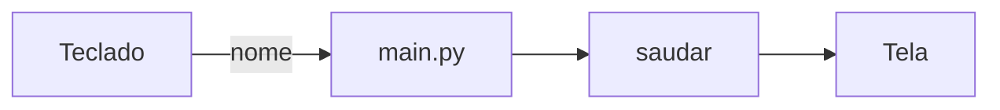

# Lesson template

Reference for the lesson branch of [SKILL.md](SKILL.md): who the reader is, how a lesson builds lasting learning, the sections every lesson has, the writing rules, and the MkDocs Material syntax the sections rely on.

## The reader

A **beginner**: comfortable with a computer, new to the stack. They have never opened a terminal for this, never used the libraries, never seen the patterns. Every term is explained the first time it appears; every command says where to run it and what should come out; every line of code the reader types has a reason they can read.

That is the baseline. The learner's state in `course/` moves it: what a learning record says they already know gets a one-line recap and a link; what they got stuck on comes back in the next lesson's recall questions and gets a callout where it reappears; their mission decides which examples and connections land; their `NOTES.md` preferences shape the tone.

## How a lesson makes learning last

Two strengths to keep apart. **Fluency** is recalling something right after reading it; it feels like mastery and fades in days. **Storage** is still having it weeks later, and it is the goal. It comes from desirable difficulty:

- **Retrieval**: the learner pulls an answer from memory before seeing it (recall questions, predictions, exercises done without looking back).
- **Spacing**: earlier lessons come back later (recall at the start, review questions in the quiz).
- **Interleaving**: exercises mix this lesson's skill with earlier ones.
- **Feedback**: every attempt gets an immediate verdict, ideally automatic (a test that turns green, a hidden answer one click away).

Difficulty is a tool for practice and an enemy for explanation: the Conceitos and Mão na massa sections stay as clear and light as possible so working memory goes to understanding; the effort goes into Relembrando, Pare e pense, Exercícios and Quiz.

Each lesson delivers **one tangible win**: something the learner runs and sees working, tied to their mission.

## Sections

Every lesson has these sections, in this order. Headings below are the pt-BR defaults; translate them when the project speaks another language.

1. **`# NN. <Título>`** then **`## Objetivos desta aula`**: "Ao final desta aula você vai entender:" and "E vai ter construído:" lists, and the tangible win in one sentence.
2. **`## Onde estamos`**: two or three lines recapping the previous lesson, with a link to it, and where this lesson sits in the course map. From the second lesson on, follow it with **`### Relembrando`**: two or three questions the learner answers from memory before reading on, answers hidden, drawn from earlier lessons and weighted toward what the learning records say was shaky. The first lesson points to `index.md` and has no recall.
3. **`## Antes de começar`**: what must already be true (previous lesson finished, its tests green, with the command to check) and every new tool this lesson needs. Installation goes inside `!!! info "Caso nunca tenha usado <ferramenta>"`, with one tab per operating system, pulled from `course/includes/` when the block exists there.
4. **`## Conceitos`**: one `###` per concept new in this lesson (about three at most). For each: what it is in plain words, an everyday analogy, the problem it solves (what goes wrong without it), and how it shows up in this project. Bold the glossary term on first use and link it to `glossario.md`. Draw a `mermaid` diagram whenever there is a flow, a sequence or a relationship between parts. Cite the source, read this session, at the end of the concept.
5. **`## Ponte teoria → projeto`**: why these concepts answer this ticket's requirement, linking the user story, ADRs and decisions they come from, and one sentence on why it matters for the learner's mission.
6. **`## Mão na massa`**: small numbered steps, `### Passo N — <ação>`. Each step opens with one or two sentences on what we are about to do and why, then:
   - a code block with `title="<caminho/do/arquivo>"` and `linenums="1"`, about 15 lines at most; when editing an existing file, show the whole region touched and mark the changed lines with `hl_lines`;
   - numbered annotations (`# (1)!`) on every line that is not self-evident, each explaining what the line does **and why this way** (and, when there is an obvious alternative, what it would get wrong);
   - for every command: a command block titled `$ Execução no terminal` (saying which folder to run it from), a separate output block titled `Saída esperada` with the real output from the replay, and an `O que aconteceu` paragraph reading that output for the reader.

   Place one or two **Pare e pense** prompts at the moments where a prediction teaches the most: before a command whose output surprises, ask what the learner expects, answer hidden.
7. **`## Testando`**: the tests for this lesson, annotated line by line, the command to run them and the real green output. The first time a test runner appears, explain how to read its output.
8. **`## Erros comuns`**: two to four mistakes a beginner is likely to make here (a typo in a name, the wrong folder, a missing dependency, a forgotten step), each with the real error message (reproduced in the replay whenever cheap), its cause, and the fix. A misconception from the learning records that touches this lesson goes here too.
9. **`## Código completo desta aula`**: every file the lesson touched, in full, one collapsible `??? example "Arquivo completo: <caminho>"` per file.
10. **`## Exercícios`**: two to four incremental exercises that extend what was just built, at least one mixing in a skill from an earlier lesson. Each comes with the test that checks it, shown in the open: the exercise is done when that test turns green, so the feedback is immediate and needs nobody. The learner tries before scrolling back to the lesson code; the solution waits inside `??? tip "Solução"`. In the replay, each exercise test fails before its solution and passes after it.
11. **`## Quiz de fixação`**: three to five questions, one or two of them reviewing earlier lessons. Prefer recall ("explique com suas palavras", "o que acontece se...") over recognition. Each question is a collapsible `??? question "<N>. <pergunta>"` holding the answer and why it is right. Multiple choice lists the options in the open, all with the same length and form, so formatting gives nothing away; the hidden answer also says why each other option is wrong.
12. **`## Commit`**: the git commands for the reader to run and a suggested commit message. The first lesson that commits explains what a commit is and why we make one per lesson.
13. **`## Resumo`**, then:
    - **`## Fonte principal`**: the single best source for this lesson's content, from `docs/recursos.md`, with one line on what to read in it;
    - **`## Para saber mais`**: the other sources cited above;
    - a `!!! question "Ficou com dúvida?"` reminding the learner that the agent is their teacher: ask it anything unclear, pasting the exact error message and what they tried, and pointing to the communities in `docs/recursos.md` when the learner wants them;
    - the next lesson: a link when that page exists, its title in plain text otherwise.

## Writing rules

- Second person, encouraging and honest: when something is hard, say so and explain it step by step.
- Explain **why** every method, library and pattern was chosen, never only what it does.
- One idea per step. Longer code is built across several steps; the full file only appears in section 9.
- One word per concept: the glossary's. A concept never changes name between lessons.
- Reuse before writing: a block already in `course/includes/` is included, never rewritten; a block a second lesson will need becomes an include.
- Every output in the page is real, pasted from the replay. Numbers, error messages and test results are never invented.
  - Lines that depend on the machine (absolute paths, tool versions, timings, the test runner's platform header) are trimmed or shortened to `...`, and the page says those lines vary; everything else stays verbatim.
  - A program that reads the keyboard is captured through a pseudo-terminal that answers only after the prompt appears, so the page shows prompt, typed text and response in the order the reader sees them (a pipe hides the typed text; `script` with piped input shows it before the prompt):

    ```python
    import os, pty, time
    pid, fd = pty.fork()
    if pid == 0:
        os.execvp("uv", ["uv", "run", "python", "src/main.py"])
    out = b""
    while b"<fim da pergunta>" not in out:
        out += os.read(fd, 1024)
    os.write(fd, b"<resposta>\n")
    time.sleep(0.5)
    try:
        while chunk := os.read(fd, 1024):
            out += chunk
    except OSError:
        pass
    print(out.decode().replace("\r", ""))
    ```
- Formulas go in a code block in plain notation. LaTeX renders only when the site has `pymdownx.arithmatex` and MathJax configured, which the default scaffold does not.
- Lessons are written before the code exists, so they show code inline. `pymdownx.snippets` with named sections (`# --8<-- [start:nome]` / `[end:nome]` in the source file) is reserved for files that already exist in the repo, and for the blocks in `course/includes/`.
- `mkdocs build --strict` turns warnings into errors: a link to a page that does not exist yet, or to a heading anchor spelled differently from its slug (slugs drop symbols such as `→`), fails the build. Link only to pages that exist and check anchors against the built HTML.
- Language and naming follow the project's `AGENTS.md` and decisions.

## Syntax the sections use

Everything below needs the extensions and features set up in [SCAFFOLD.md](SCAFFOLD.md).

A step in `## Mão na massa`, with annotations, a prediction, command and output:

````markdown
### Passo 2 — Criar a função de saudação

Vamos criar a função que monta a mensagem. Ela fica num arquivo próprio para que os testes consigam importá-la sem executar o programa inteiro.

```python title="src/saudacao.py" linenums="1"
def saudar(nome: str) -> str:  # (1)!
    return f"Olá, {nome}!"  # (2)!
```

1.  `def` cria uma função chamada `saudar`. O `: str` depois de `nome` é uma *anotação de tipo*: avisa a quem lê (e ao editor) que esperamos um texto.
2.  O `f` antes das aspas cria uma *f-string*: o que estiver entre `{}` é trocado pelo valor da variável. É o jeito mais legível de montar textos em Python.

??? question "Pare e pense: o que vai aparecer se você trocar `'Ana'` por `''` no comando abaixo?"

    `Olá, !` — a função não confere se o nome está vazio; ela só encaixa o texto que recebe.

```bash title="$ Execução no terminal (na pasta do projeto)"
uv run python -c "from saudacao import saudar; print(saudar('Ana'))"
```

```text title="Saída esperada"
Olá, Ana!
```

**O que aconteceu:** o `uv run` executou o Python dentro do ambiente do projeto, importou a função que acabamos de escrever e imprimiu o resultado.
````

Code annotations need the list right after the block, numbered from 1, with the text indented four spaces. The `!` in `# (1)!` removes the comment from the rendered code, leaving only the clickable marker. Material builds the annotations in the browser, so the static HTML only holds the `# (1)!` comment followed by an `<ol>`: a passing `--strict` build does not prove they render. Check that each annotated block is followed by its `<ol>` in the built page, and preview with `mkdocs serve` when a browser is at hand.

A reusable block from `course/includes/`, pulled into an admonition (indent the include line to the block's level):

````markdown
!!! info "Caso nunca tenha usado o uv"

    --8<-- "course/includes/instalar-uv.md"
````

Installation per operating system, as it would live inside `course/includes/instalar-uv.md`:

````markdown
O `uv` instala o Python e as bibliotecas do projeto num ambiente isolado.

=== "Linux / macOS"

    ```bash
    curl -LsSf https://astral.sh/uv/install.sh | sh
    ```

=== "Windows"

    ```powershell
    powershell -ExecutionPolicy ByPass -c "irm https://astral.sh/uv/install.ps1 | iex"
    ```
````

An exercise with its test and hidden solution:

````markdown
1. Faça `saudar` aceitar um parâmetro opcional `formal`: com `formal=True`, a resposta é `"Prezado(a) <nome>."`. O exercício está pronto quando este teste passar:

    ```python title="tests/test_exercicio_01.py"
    from saudacao import saudar


    def test_saudar_formal():
        assert saudar("Ana", formal=True) == "Prezado(a) Ana."
    ```

    ```bash title="$ Execução no terminal (na pasta do projeto)"
    uv run pytest tests/test_exercicio_01.py
    ```

??? tip "Solução"

    ```python title="src/saudacao.py"
    def saudar(nome: str, formal: bool = False) -> str:
        if formal:
            return f"Prezado(a) {nome}."
        return f"Olá, {nome}!"
    ```
````

A recall question and a multiple-choice question with options of equal length:

````markdown
??? question "1. Com suas palavras: por que a função fica em `src/saudacao.py` e não no `main.py`?"

    Para que os testes possam importá-la sem rodar o programa inteiro. Se ela ficasse no `main.py`, importar o arquivo executaria o `input`, e o teste ficaria esperando alguém digitar.

**2. O que o `uv run` faz antes de executar o comando?**

- a) Ativa o ambiente do projeto
- b) Instala o Python do sistema
- c) Apaga o ambiente do projeto

??? question "Resposta da 2"

    **a)**. O `uv run` executa o comando dentro do ambiente do projeto. O b) está errado porque o `uv` usa o Python do ambiente, não o do sistema; o c) porque nada é apagado.
````

A diagram:

````markdown

````

Other callouts: `!!! tip` for shortcuts, `!!! warning` for things that break silently, `!!! note` for side remarks.
